# RV32I Single-Cycle / Multi-Cycle CPU

RISC-V **RV32I** 명령어를 지원하는 Single-Cycle CPU를 SystemVerilog로 설계하고, Bubble Sort Machine Code로 동작을 검증한 뒤
타이밍 위반을 해결하기 위해 **5-state Multi-Cycle 구조로 확장**한 개인 프로젝트입니다.

| 항목 | 내용 |
|---|---|
| 기간 | 2026.05.19 ~ 2026.05.27 |
| 형태 | 개인 프로젝트 |
| ISA | RISC-V RV32I — R / I / S / IL / UL / UA / B / J / JL 9개 타입, 37개 명령어 |
| 보드 | Digilent Basys 3 (Artix-7 XC7A35T), 100 MHz |
| 도구 | Vivado (Synthesis · Implementation · Simulation) |

## 핵심 결과

- RV32I **37개 명령어**를 구현하고 0~10 누적합 · **Bubble Sort(104 word)** Machine Code로 실행 검증
- Single-Cycle 100 MHz 구현에서 **WNS −3.348 ns** (946개 Endpoint 중 146개 Setup 위반)
- Multi-Cycle(FETCH → DECODE → EXECUTE → MEM → WB) 전환 후 **WNS +0.425 ns**, 위반 Endpoint 0개로 100 MHz 충족
- 구조별 트레이드오프: LUT 1,100 → 1,275, FF 48 → 251, 전력 0.167 W → 0.153 W (**−8.4%**)

## 아키텍처

**CPU Flow (Harvard 구조)**: Instruction ROM과 Data RAM을 분리하고, PC는 Byte Addressing으로 명령어마다 4씩 증가합니다.

<p align="center">
  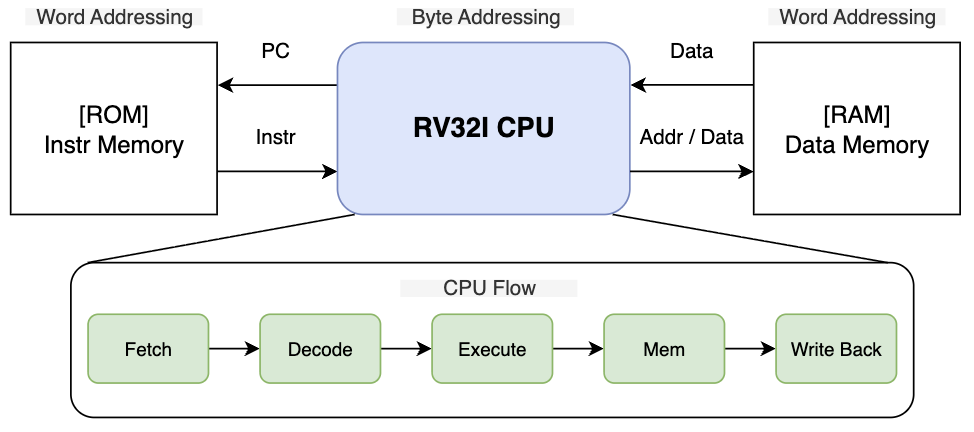
</p>

**Top Block Diagram**

<p align="center">
  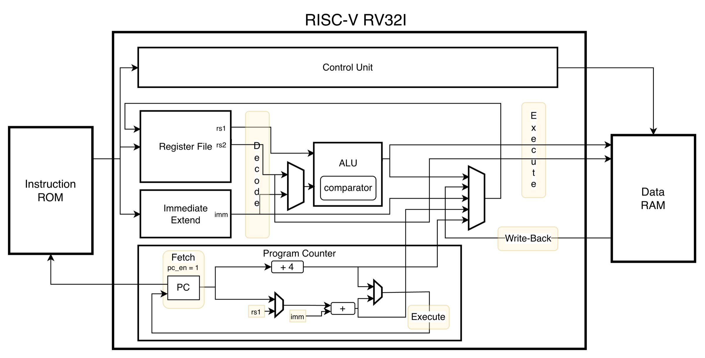
</p>

- **Control Unit / Datapath 분리**: `opcode` · `funct3` · `funct7`을 디코딩해 R/I/S/B/U/J 타입별 Control Signal을 생성합니다.
- **Datapath**: PC, Register File(`x0`는 0 고정), Immediate Extend, ALU, Instruction ROM, Data RAM(`mem_mapper`)
- **Multi-Cycle**: 5-state FSM과 단계 사이 레지스터로 Critical Path(ROM → Register File → ALU → RAM → Write-Back)를 단계별로 나눴습니다.

**Control Unit Truth Table**: 명령어 타입별 Control Signal (Don't Care 값은 안정성을 위해 0으로 할당)

<p align="center">
  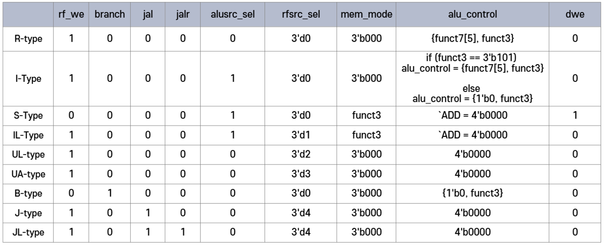
</p>

## 지원 명령어

| 타입 | 명령어 |
|---|---|
| R-type | `ADD` `SUB` `SLL` `SLT` `SLTU` `XOR` `SRL` `SRA` `OR` `AND` |
| I-type (ALU) | `ADDI` `SLTI` `SLTIU` `XORI` `ORI` `ANDI` `SLLI` `SRLI` `SRAI` |
| IL-type (Load) | `LB` `LH` `LW` `LBU` `LHU` |
| S-type (Store) | `SB` `SH` `SW` |
| B-type | `BEQ` `BNE` `BLT` `BGE` `BLTU` `BGEU` |
| U-type | `LUI` `AUIPC` |
| J / JL | `JAL` `JALR` |

**Instruction Field**: `opcode`로 명령어 타입을 구분하고, 타입마다 Field 구성이 다릅니다.

<p align="center">
  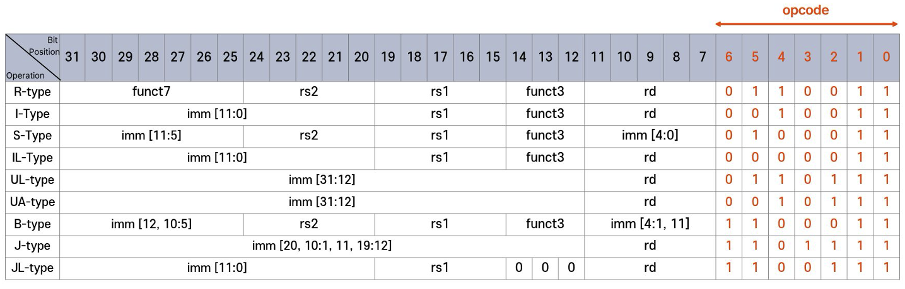
</p>

### 명령어 타입별 상세

<details>
<summary><b>R-type · 3개의 Register를 활용하는 연산</b></summary>

<p align="center">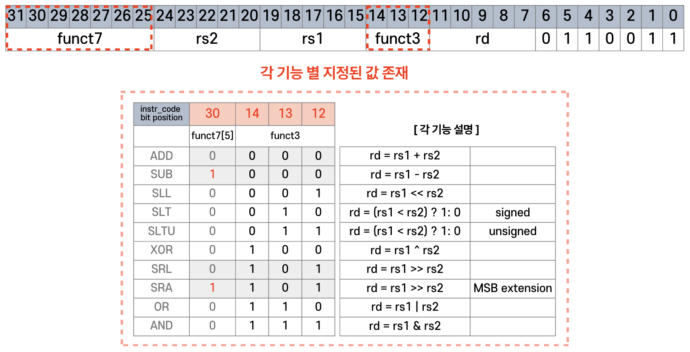</p>

`funct7[5]`와 `funct3`로 ALU 연산 종류를 선택합니다 (SUB · SRA는 `funct7[5] = 1`).

</details>

<details>
<summary><b>I-type · Immediate 연산</b></summary>

<p align="center">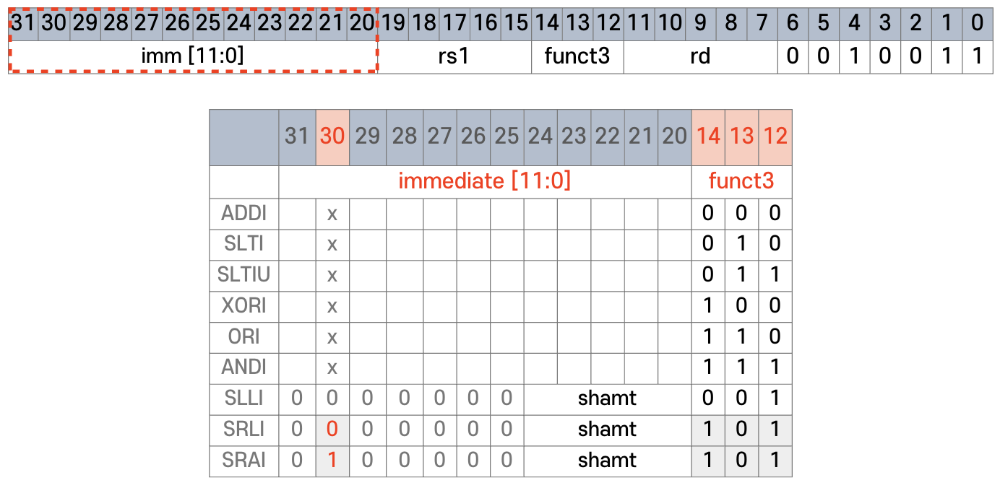</p>

Shift 명령어(`SLLI` · `SRLI` · `SRAI`)는 `imm[11:5]` 자리에 `funct7`이 들어가므로, R-type과 같은 방식으로 `alu_control`을 만듭니다.

<p align="center">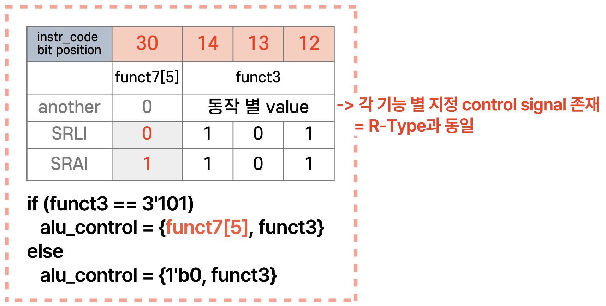</p>

</details>

<details>
<summary><b>S-type · Data Memory Store</b></summary>

<p align="center">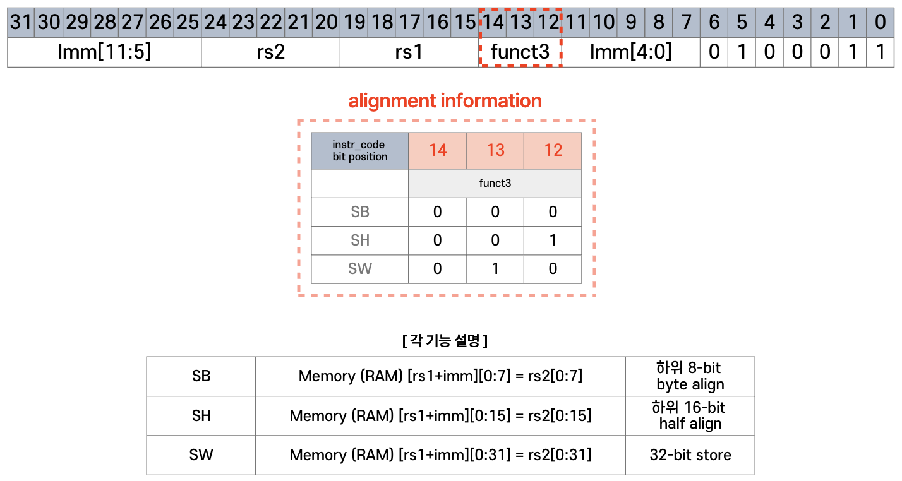</p>

`funct3`가 Store 단위(Byte / Half / Word) alignment 정보를 담습니다.

</details>

<details>
<summary><b>IL-type · Data Memory Load</b></summary>

<p align="center">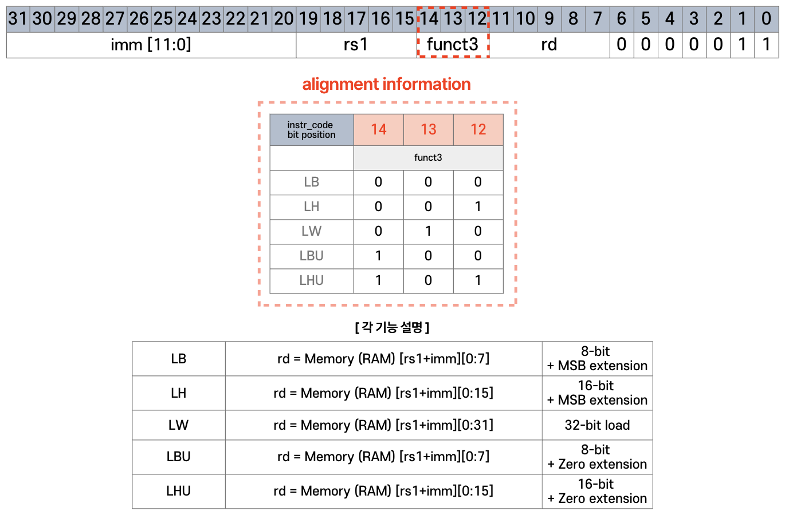</p>

`funct3`로 Load 단위와 Sign / Zero Extension을 구분합니다.

</details>

<details>
<summary><b>U-type · LUI / AUIPC</b></summary>

**UL-type (LUI)**: `rd = {imm, 12'b0}`

<p align="center">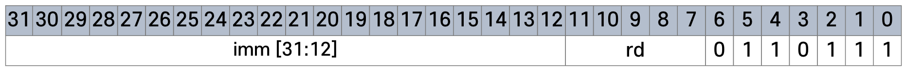</p>

**UA-type (AUIPC)**: `rd = PC + {imm, 12'b0}`

<p align="center">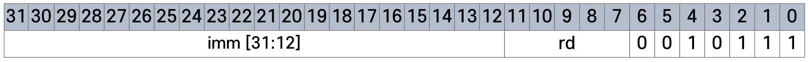</p>

</details>

<details>
<summary><b>B-type · 조건 분기</b></summary>

<p align="center">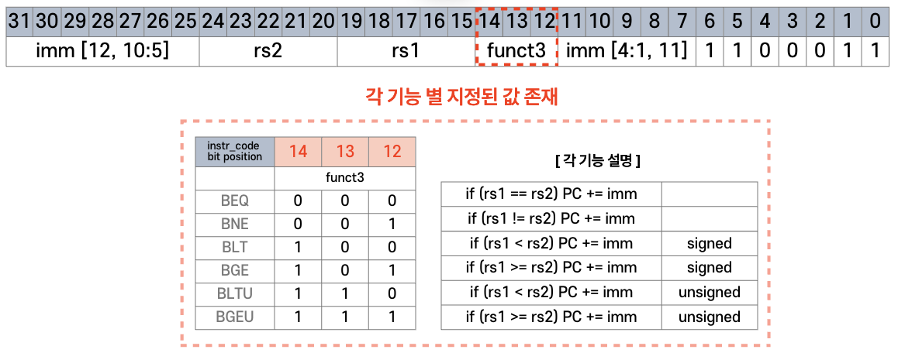</p>

`funct3`로 비교 종류(signed / unsigned)를 선택하고, 조건이 참이면 `PC += imm`으로 분기합니다.

</details>

<details>
<summary><b>J-type · JAL</b></summary>

<p align="center">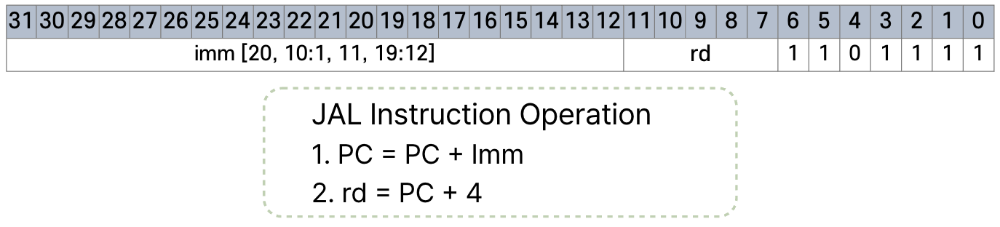</p>

분기 전 다음 실행 위치(`PC + 4`)를 `rd`에 저장하고 `PC + Imm`으로 이동합니다.

<p align="center">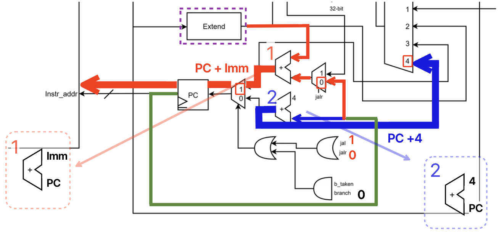</p>

</details>

<details>
<summary><b>JL-type · JALR</b></summary>

<p align="center">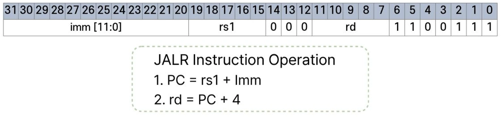</p>

`jalr = 1`이면 PC 가산기 입력이 `PC` 대신 `rs1`로 바뀌어 `rs1 + Imm`으로 이동합니다. 함수 복귀(`ret`)에 사용됩니다.

<p align="center">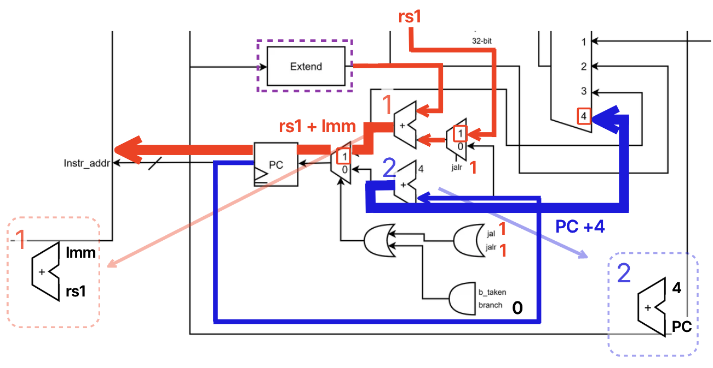</p>

</details>

## 검증

| 단계 | 내용 |
|---|---|
| 명령어 단위 | R-type `SRL`/`SRA`의 Zero/MSB Extension 비교, I-type `ADDI`·`SRAI`·`SLTI`, S/IL-type 전 명령어 Load/Store 주소 매핑 |
| 분기 · 점프 | Branch Taken / Not Taken, `JAL` / `JALR` PC 갱신 |
| 프로그램 | C 코드 → Instruction Hex 변환 → 0~10 누적합, Bubble Sort (함수 호출 · Stack Pointer · Load/Store · 조건 분기) |

**Bubble Sort 실행 검증**: `[3, 5, 9, 1, 7]` → `[1, 3, 5, 7, 9]`. 함수 호출 시 Stack 영역에 Return Address · Saved Pointer가 저장되고 복귀하는 과정을 RAM과 파형으로 확인했습니다.

## 트러블슈팅: Single-Cycle 타이밍 위반

- **문제**: 100 MHz Implementation 결과 WNS −3.348 ns, TNS −348.676 ns, 946개 Endpoint 중 146개에서 Setup 위반 발생
- **원인**: Single-Cycle은 한 클럭 안에 Fetch부터 Write-Back까지 수행하므로, ROM → Register File → ALU → RAM → Write-Back이 하나의 Critical Path로 연결됨
- **해결**: FETCH → DECODE → EXECUTE → MEM → WB 5-state FSM 기반 Multi-Cycle로 전환하고, 단계 사이에 레지스터를 삽입해 Critical Path를 분할
- **결과**: WNS +0.425 ns, 위반 Endpoint 0개(0 / 1,179)로 100 MHz 충족. FF는 48 → 251개로 늘었지만 전력은 8.4% 감소

| Single-Cycle (100 MHz) | Multi-Cycle (100 MHz) |
|---|---|
| 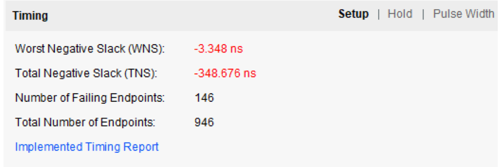 | 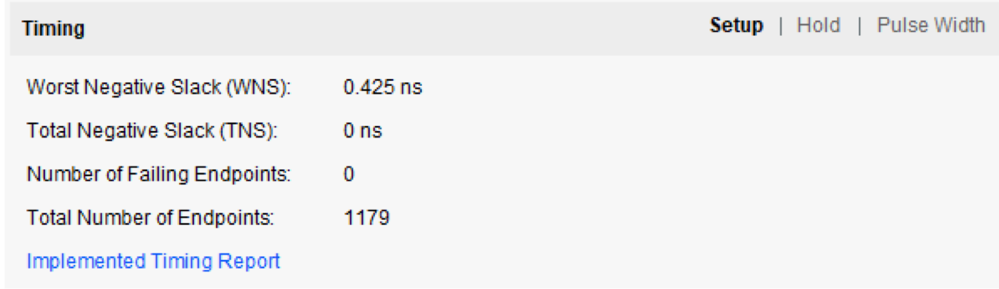 |

## 디렉터리 구조

```text
.
├── rv32i_cpu.sv            # CPU Top (Control Unit + Datapath)
├── control_unit.sv         # opcode / funct 디코딩 → Control Signal
├── rv32i_datapath.sv       # PC · Register File · ALU · Imm Extend · MUX
├── instruction_mem.sv      # Instruction ROM
├── data_mem.sv             # Data RAM
├── define.vh               # opcode / ALU 제어 정의
├── instruction_code.mem    # 실행 Machine Code
├── top_rv32i_soc.sv        # 보드 Top
├── tb_rv32i.sv             # Single-Cycle Testbench
├── Basys-3-Master.xdc
├── docs/                   # README 이미지
└── MulticycleCPU/          # 5-state Multi-Cycle CPU (control_unit · datapath · tb_multi_rv32i 등)
```

## 개선 방향

- 5-stage Pipeline 구조로 확장
- Data / Control Hazard 처리를 위한 Forwarding · Stall · Branch Predictor 추가
